# TP4 - Héritage JPA avec Hibernate

Projet Maven avec Hibernate et H2 pour tester les trois stratégies d'héritage (SINGLE_TABLE, JOINED, TABLE_PER_CLASS) sur une hiérarchie de véhicules : Voiture, Moto, Camion.

## Captures

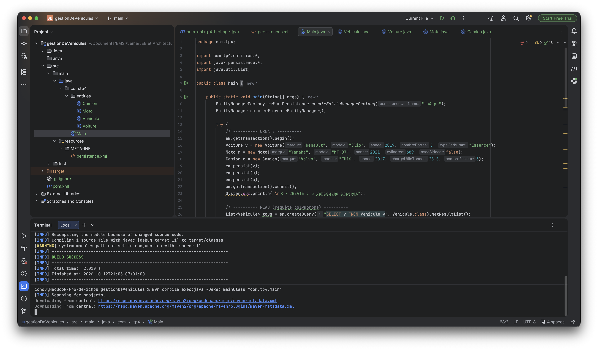

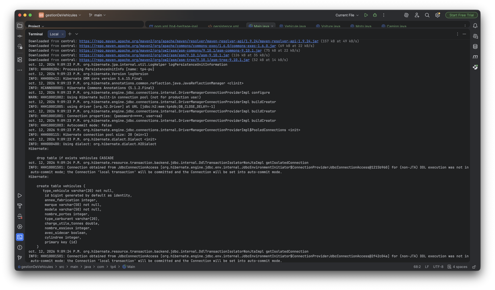

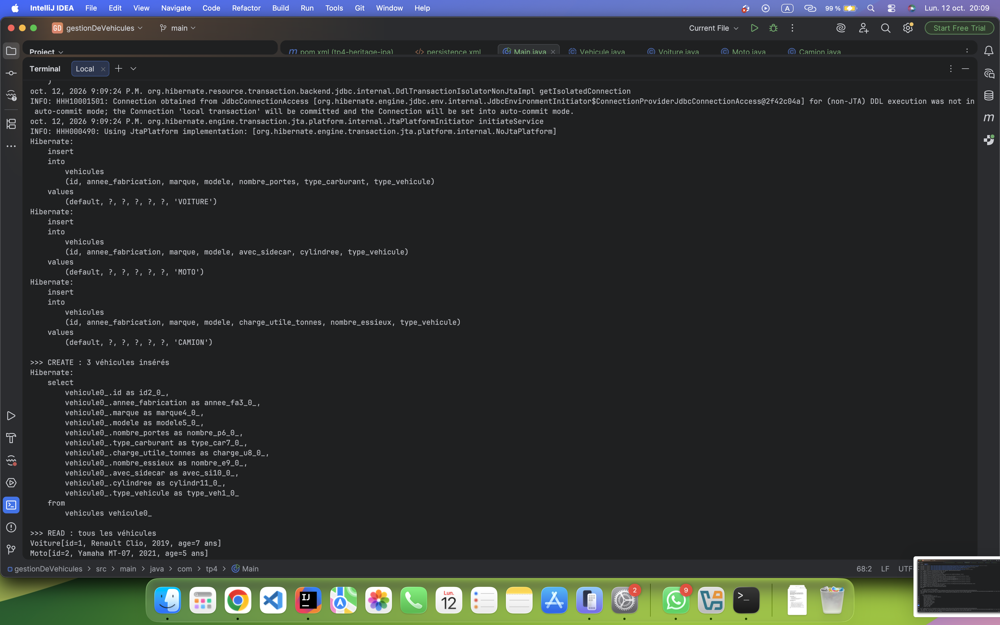

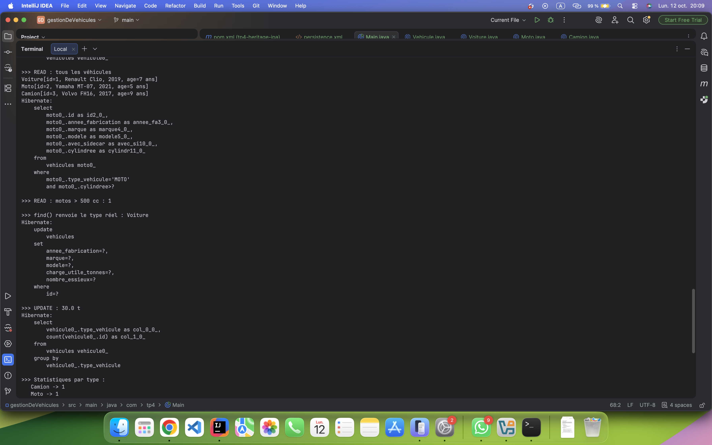

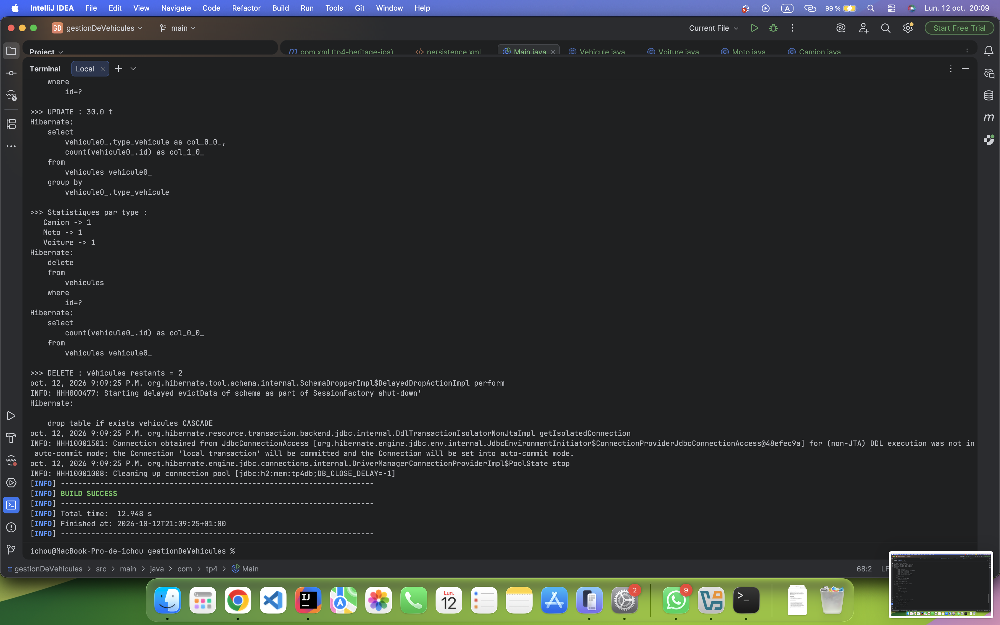

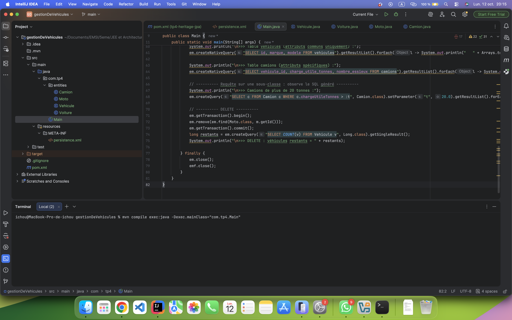

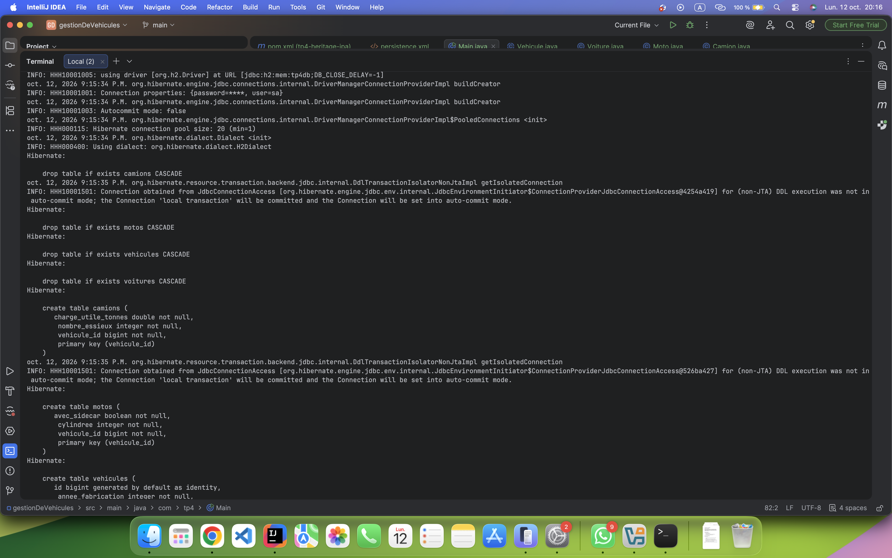

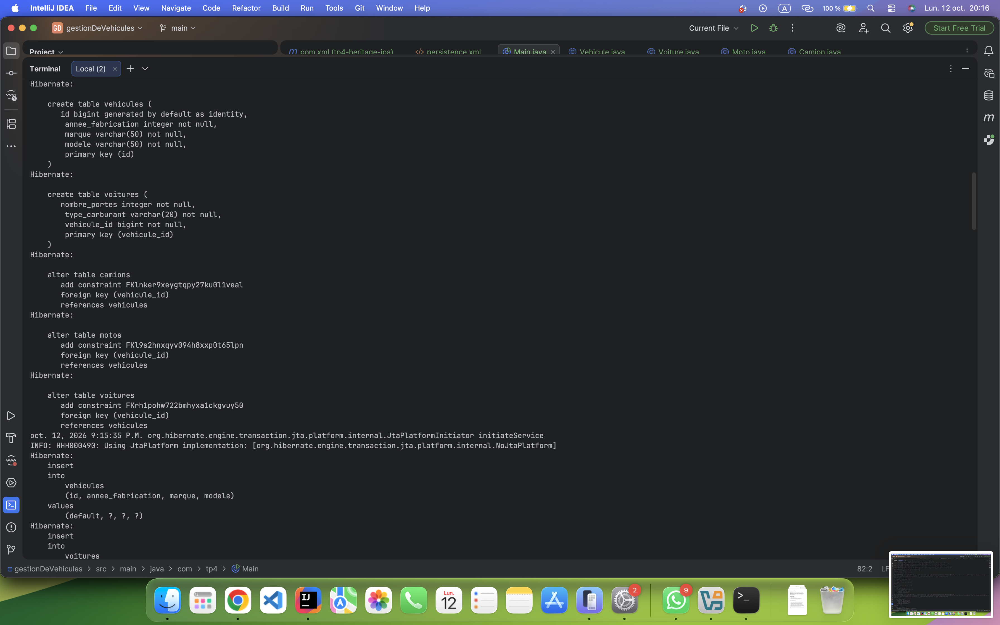

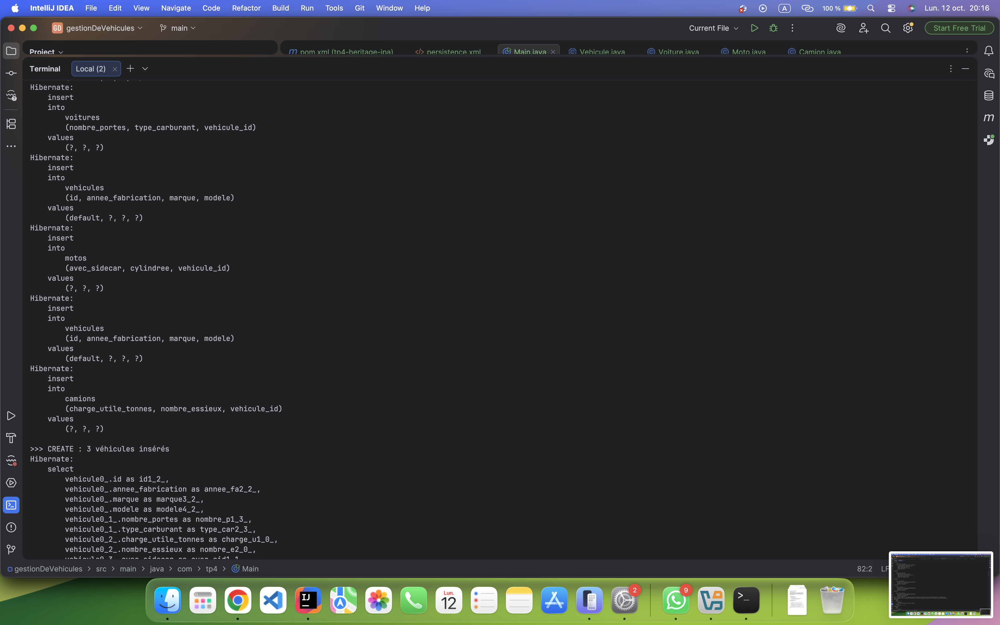

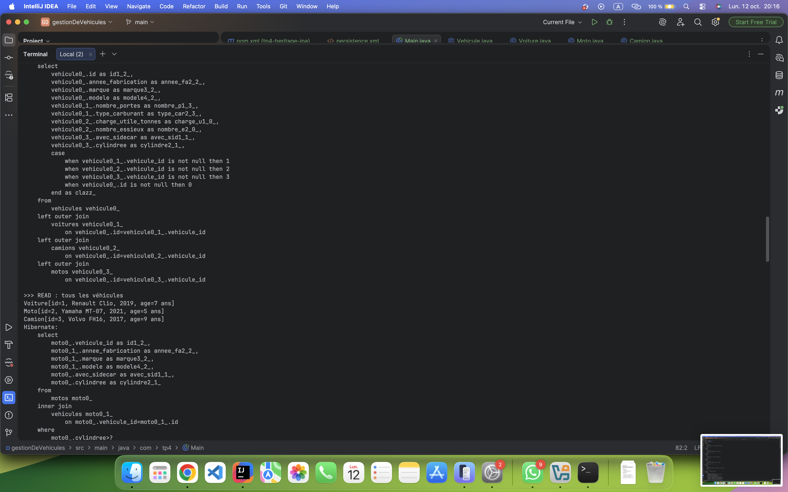

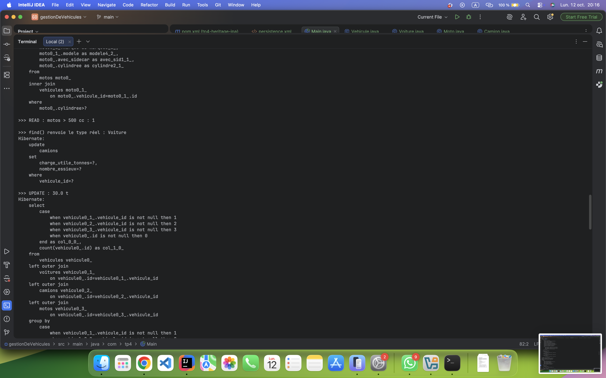

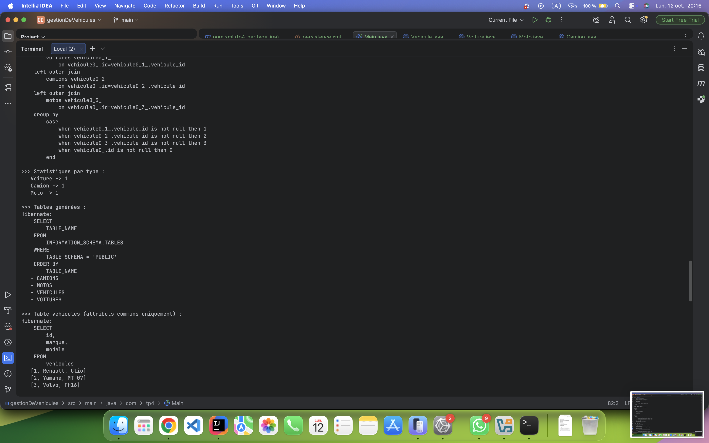

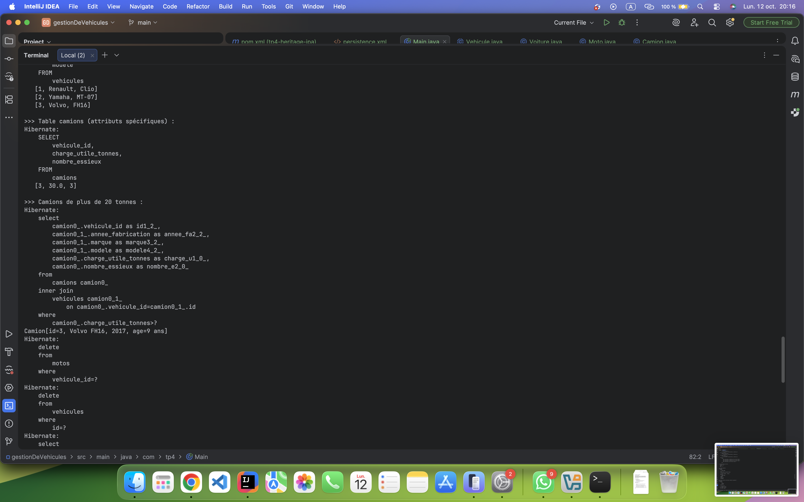

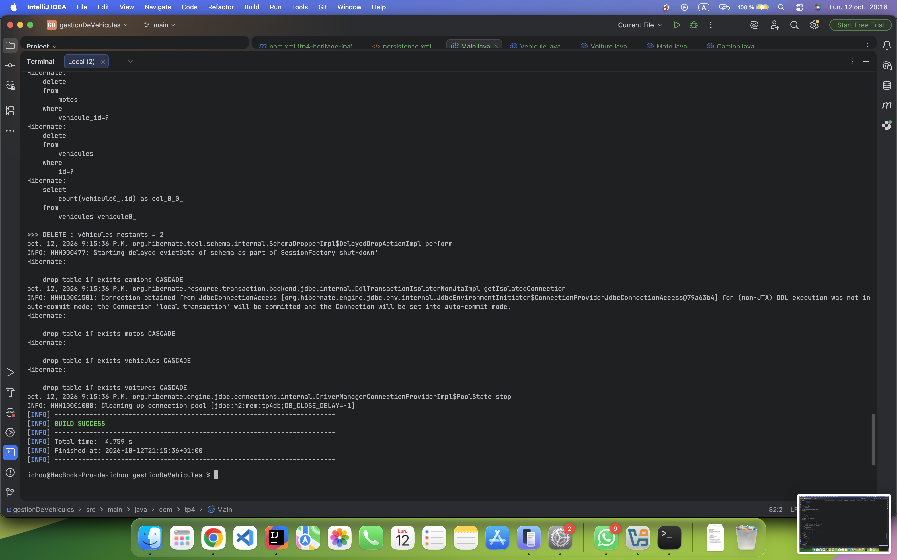

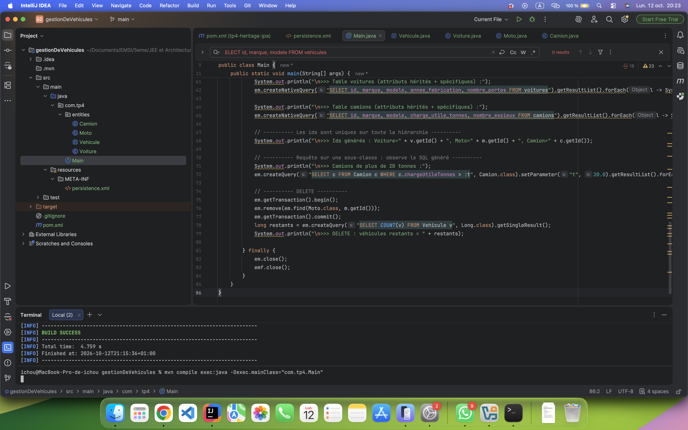

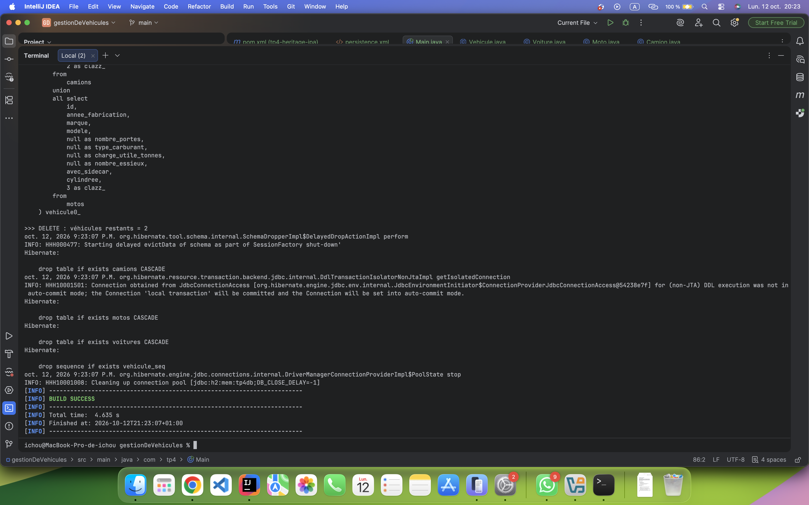
